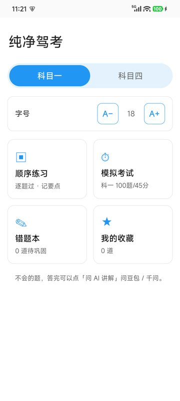
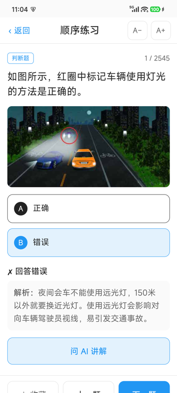
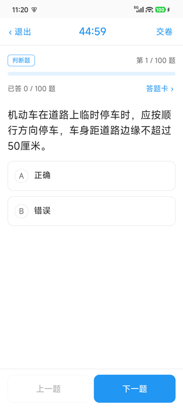
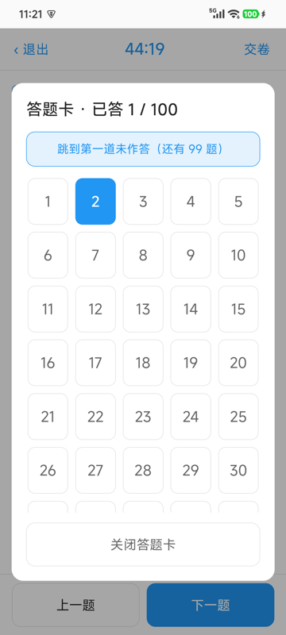
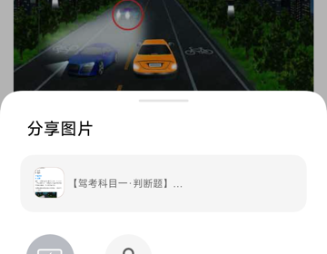

<div align="center">

# Chun Jing Jia Kao (纯净驾考)

**A distraction-free Android driving-test app for seniors · China Subject 1 / Subject 4 · large type · no ads · fully offline**

[简体中文](README.md) · [Contributing](CONTRIBUTING.md) · [Third-Party Notice](NOTICE.md)

---

### 📥 Download the Android APK

## [👉 Download the latest app-debug.apk (~57 MB)](https://github.com/nujgnoix/chun-jing-jia-kao/releases/latest/download/app-debug.apk)

[All releases](https://github.com/nujgnoix/chun-jing-jia-kao/releases) · [Latest release page](https://github.com/nujgnoix/chun-jing-jia-kao/releases/latest)

> This is an **Android application (.apk)** — not a website and not an iOS app.
> Enable "install from unknown sources" on your phone. Builds are currently debug-signed.
> The entire question bank and all images are bundled, so **it works fully offline**.

[](LICENSE)


</div>

---

## Why this exists

Most driving-test apps are full of ad pop-ups, upsells and "share to unlock" prompts — easy for an elderly user to tap by mistake. And when the phone's system-wide "senior mode / large font" is on, their layouts get scaled a second time and fall apart.

This app started as a small gift for a 60-year-old family member preparing for the Chinese driving theory exam: big text, big buttons, nothing else, and a one-tap way to ask an AI about a confusing question. So it:

- Has **no ads, no in-app purchases, no share-bait, and no analytics or tracking SDKs**
- **Controls its own font size**: the native layer pins WebView text zoom to 100%, so the OS font scale cannot break the layout; `A− / A+` controls are available on both the home and practice screens
- Works **fully offline**: 4,378 questions and 1,428 images ship inside the APK

## Screenshots

| Home | Practice with feedback |
| :---: | :---: |
|  |  |

| Mock exam | Answer sheet (opens on demand, enlarged cells) |
| :---: | :---: |
|  |  |

**Ask an AI to explain**: the question text and the original image are composed into a single card, shared to Doubao / Qwen.



## Features

| Module | Description |
| --- | --- |
| Subject switch | Subject 1 / Subject 4, one tap |
| Sequential practice | Instant grading and explanation; wrong answers go to the review list automatically |
| Mock exam | Subject 1: 100 questions / 45 min; Subject 4: 50 / 30 min; pass at 90. Fixed bottom "Previous / Next" bar plus a progress bar; submit confirmation warns about unanswered questions |
| Answer sheet | Collapsed by default; large cells, highlights current / answered questions, "jump to first unanswered" shortcut |
| Review list / Favorites | Stored locally |
| Font size | Adjustable on home and practice pages (14–30 px) |
| Ask AI | Composes the question, options, answer, explanation and image into one card and opens the Android share sheet for Doubao / Qwen |

### Details that matter for seniors

- **Fixed bottom action bar** — navigation buttons stay visible no matter how long the explanation is
- Auto-scrolls to the feedback after answering, and back to the top of the question when switching
- Bottom safe-area insets so gesture navigation never covers buttons
- **Only one share sheet** is opened and nothing is written to the clipboard; the target app opens in its own task, so returning to this app takes one step
- **Submit confirmation** prevents accidentally ending an exam

## Install

1. Download `app-debug.apk` from [Releases](https://github.com/nujgnoix/chun-jing-jia-kao/releases/latest)
2. Open it on your phone and allow "install from unknown sources" when prompted
3. Launch **纯净驾考** — **no network, no account, no sign-in**

> Each CI build produces a fresh debug signing key, so a cross-version update may report a signature mismatch. Uninstall the old version first.

## This is an Android project

The UI is a **Vue 3 + Vite** single-page app packaged as a native **Android** APK with **Capacitor 8** (web assets, question bank and images all live in `assets/`). The same codebase also runs in a browser for H5 preview, but **the primary deliverable is the Android APK**.

| Item | Detail |
| --- | --- |
| Package | `com.jiaxiao.study` |
| Frontend | Vue 3, Vite, plain CSS (no third-party UI library) |
| Native container | Capacitor 8 (`@capacitor/app`, `@capacitor/share`, `@capacitor/filesystem`) |
| Build toolchain | Node 22, JDK 21, Android SDK platform 36 / build-tools 36.0.0 |
| CI | GitHub Actions builds the APK and publishes a Release on every push to `main` |
| Data | `public/bank.json` (2,545 + 1,833 questions), `public/images/` (1,428 images) |

The APK is ~57 MB, mostly due to the offline question images.

## Run and build locally

```bash
npm install
npm run dev      # H5 preview at http://localhost:5173
npm run build    # outputs www/
```

Building the APK locally requires JDK 21 and the Android SDK; the GitHub Actions workflow is easier (see [CONTRIBUTING.md](CONTRIBUTING.md)):

```bash
npm install
npx vite build --outDir www
npx cap add android
python3 scripts/patch-share-plugin.py   # opens shared-to apps in a separate task
npx cap copy android
cd android && ./gradlew assembleDebug
```

You can also trigger `Build Android APK` manually from the Actions tab.

## About the question bank

The bank is compiled from publicly available open data: **2,545 Subject 1 + 1,833 Subject 4 questions**, with answers normalised to letter format.

> ⚠️ The data reflects regulations from around 2022, which are revised periodically. **Always defer to the latest official question bank published by the Chinese authorities.** This app is for practice only and is not an exam reference.

## Credits (data sources)

With sincere thanks to the open-source authors and resources that made this offline bank possible:

- **Subject 1 / Subject 4 question text**: [doupoa/DrivingTestSubjectOne](https://github.com/doupoa/DrivingTestSubjectOne) (`q.json` contains both sets)
- **Additional Subject 1 data**: [AgentMystia/driving-test-subject1](https://github.com/AgentMystia/driving-test-subject1)
- **Subject 4 cross-reference**: [GaoJiasheng/driving-quiz-app](https://github.com/GaoJiasheng/driving-quiz-app) (`cn_subject4_v1.json`)
- **Question images**: Chetailian CDN (`app.static.public.chetailian.com`, chetailian.com)

## License

This project is fully open source under the **[MIT License](LICENSE)** — use, modify, redistribute and use commercially, as long as you keep the copyright notice.

> ⚠️ **Scope of the license**: MIT covers **only the original source code and documentation** in this repository. The question bank (`public/bank.json`) and question images (`public/images/`) come from third parties, remain the property of their respective owners, and are **NOT covered by the MIT grant**. See [NOTICE.md](NOTICE.md). Verify upstream licensing before redistributing or using them commercially.
>
> If any rights holder objects to the bundled assets, please open an [Issue](https://github.com/nujgnoix/chun-jing-jia-kao/issues) and we will remove them promptly.
