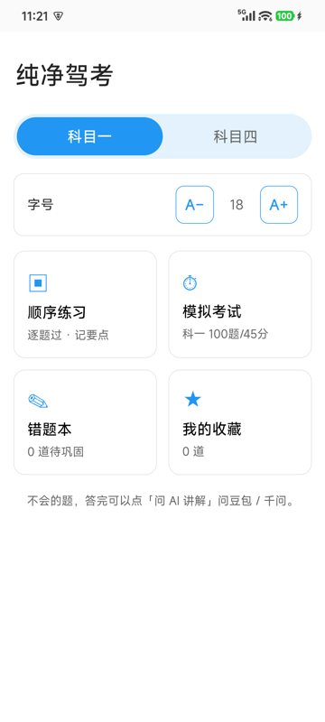
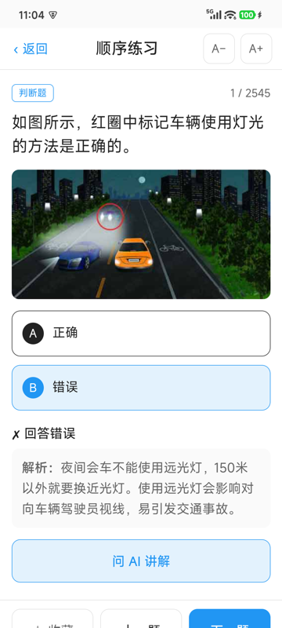
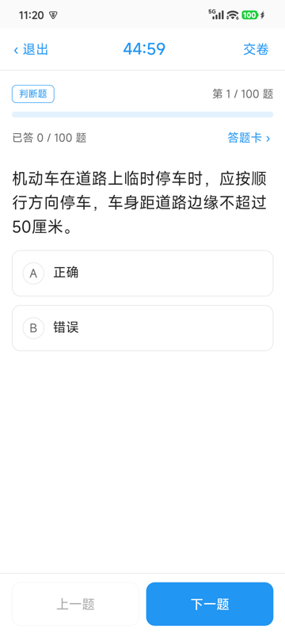
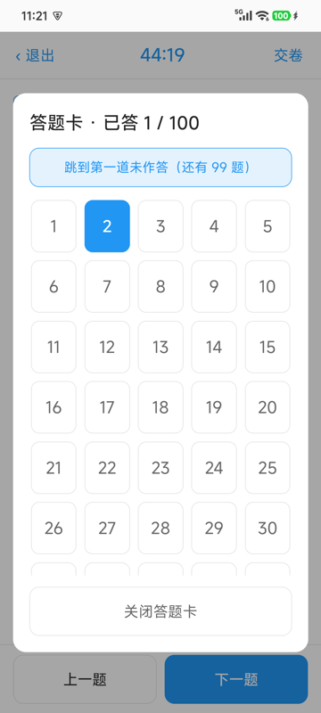
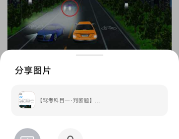

<div align="center">

# 纯净驾考

**一款给长辈用的安卓驾考 App · 科目一 / 科目四 · 大字适老 · 无广告 · 可离线**

[English](README.en.md) · [贡献指南](CONTRIBUTING.md) · [第三方素材声明](NOTICE.md)

---

### 📥 下载安卓 APK

## [👉 点此下载 app-debug.apk（最新版，约 57 MB）](https://github.com/nujgnoix/chun-jing-jia-kao/releases/download/latest/app-debug.apk)

[最新版入口](https://github.com/nujgnoix/chun-jing-jia-kao/releases/latest) · [Releases 页面](https://github.com/nujgnoix/chun-jing-jia-kao/releases)

> 这是 **Android 应用（.apk）**，不是网页，也不是 iOS 应用。
> 安装时需在手机设置里允许「未知来源安装」；当前为 debug 签名版本。
> 题库与图片全部内置，**装好后断网也能刷题**。

[](LICENSE)


</div>

---

## 为什么做这个

市面上驾考 App 常有广告弹窗、诱导充值、诱导分享，长辈很容易误点；手机再开「老人模式 / 大字模式」后，界面又会被系统二次放大到错乱。

「纯净驾考」最初只是想给家里 60 岁准备考驾照的长辈做一个**能安静刷题**的工具：字够大、按钮够大、没有多余东西、做完题还能一键把题目转给 AI 讲解。于是它：

- **不弹广告、不诱导充值、不诱导分享**，也没有任何统计 / 追踪 SDK
- **字号由 App 自己控制**：原生层锁定 WebView 字号，系统开老人模式也不会把布局撑乱；首页和答题页都能用 `A− / A+` 调字号
- **完全离线**：4378 道题与 1428 张配图全部随 APK 内置

## 截图

| 首页 | 顺序练习（答题反馈） |
| :---: | :---: |
|  |  |

| 模拟考试 | 答题卡（点开才显示，格子放大） |
| :---: | :---: |
|  |  |

**一键问 AI 讲解**：把题目文字 + 原图合成一张卡片图，转发给豆包 / 千问。



## 功能

| 模块 | 说明 |
| --- | --- |
| 科目切换 | 科目一 / 科目四，一键切换 |
| 顺序练习 | 逐题作答即时判分、显示解析，答错自动进错题本 |
| 模拟考试 | 科一 100 题 / 45 分，科四 50 题 / 30 分，90 分合格；「上一题 / 下一题」固定底栏 + 进度条；交卷二次确认并提示未作答数 |
| 答题卡 | 默认收起，需要时才展开；大格子、当前题 / 已答题高亮，支持「跳到第一道未作答」 |
| 错题本 / 收藏 | 本地保存，随时回看 |
| 字号调节 | 首页与答题页均可调，范围 14–30px |
| 一键问 AI | 把题干、选项、答案、解析与配图合成一张卡片图，调起系统分享转发给豆包 / 千问 |

### 几个为长辈做的细节

- **固定底栏**：翻页 / 收藏按钮常驻屏幕底部，解析再长也不用往下翻
- **答完自动滚到解析**，切到下一题自动回到题干顶部
- **底部安全区适配**，按钮不会被全面屏手势条挡住
- **分享只弹一次面板**，不往剪贴板塞东西；分享目标在独立任务栈打开，从 AI 回来一步可达
- **交卷二次确认**，避免误触直接结束考试

## 安装

1. 从 [Releases](https://github.com/nujgnoix/chun-jing-jia-kao/releases/latest) 下载 `app-debug.apk`
2. 在手机上打开该文件；首次会提示「未知来源」，在设置中允许本次安装即可
3. 打开「纯净驾考」开始使用，**无需联网、无需注册、无需登录**

> 每次 CI 构建都会生成新的 debug 签名，跨版本覆盖安装可能提示签名不兼容，先卸载旧版再装即可。

## 这是一个安卓项目

源码是 **Vue 3 + Vite** 写的单页应用，通过 **Capacitor 8** 打包成原生 **Android** APK（Web 资源 + 题库 + 图片都打进 `assets/`）。同一个代码库也能用浏览器直接跑 H5 预览，但**主要交付形态是安卓 APK**。

| 项目 | 内容 |
| --- | --- |
| 包名 | `com.jiaxiao.study` |
| 前端 | Vue 3、Vite、原生 CSS（无第三方 UI 库） |
| 原生容器 | Capacitor 8（`@capacitor/app`、`@capacitor/share`、`@capacitor/filesystem`） |
| 构建环境 | Node 22、JDK 21、Android SDK platform 36 / build-tools 36.0.0 |
| CI | GitHub Actions，push 到 `main` 自动构建 APK 并发布 Release |
| 数据 | `public/bank.json`（科一 2545 + 科四 1833 题）、`public/images/`（1428 张配图） |

APK 体积约 57 MB，主要来自离线题库配图。

## 本地运行与构建

```bash
npm install
npm run dev      # H5 预览 http://localhost:5173
npm run build    # 产出 www/
```

本地打 APK 需要 JDK 21 与 Android SDK，更推荐直接用 GitHub Actions 自动构建（见 [CONTRIBUTING.md](CONTRIBUTING.md)）：

```bash
npm install
npx vite build --outDir www
npx cap add android
python3 scripts/patch-share-plugin.py   # 让分享目标在独立任务栈打开
npx cap copy android
cd android && ./gradlew assembleDebug
```

也可在 Actions 页面手动触发 `Build Android APK`。

## 题库说明

题库整理自公开开源数据，合计 **科目一 2545 题 + 科目四 1833 题**，答案已统一整理为字母格式。

> ⚠️ 题库基于 2022 年前后法规整理，法规每年会有微调。**实际考试请以公安部最新官方题库为准**，临考前建议再用最新官方渠道补漏。本项目仅供学习练习，不构成考试依据。

## 致谢（数据来源）

本项目的题库与配图均来自以下开源项目与公开资源的无私分享，在此一并郑重感谢：

- **科目一 / 科目四 题库文本**：[doupoa/DrivingTestSubjectOne](https://github.com/doupoa/DrivingTestSubjectOne)（`q.json` 同时包含科目一 2545 题与科目四 1833 题）
- **科目一 题库补充**：[AgentMystia/driving-test-subject1](https://github.com/AgentMystia/driving-test-subject1)
- **科目四 题库对照**：[GaoJiasheng/driving-quiz-app](https://github.com/GaoJiasheng/driving-quiz-app)（`cn_subject4_v1.json`）
- **题目配图**：车态联 CDN（`app.static.public.chetailian.com`，chetailian.com）

没有以上开源作者与资源方的付出，就没有这份纯净、离线的题库。感谢他们！

## 开源与授权

本项目以 **[MIT License](LICENSE)** 完全开源，欢迎使用、修改、二次分发与商用，只需保留版权声明。

> ⚠️ **授权边界**：MIT 仅覆盖本项目**原创的源代码与文档**。题库文本（`public/bank.json`）与题目配图（`public/images/`）来自第三方，版权归原作者 / 原平台所有，**不在 MIT 授权范围内**，详见 [NOTICE.md](NOTICE.md)。二次分发或商用前请自行向上游确认授权。
>
> 若任何权利方认为附带素材不妥，请通过 [Issues](https://github.com/nujgnoix/chun-jing-jia-kao/issues) 联系，我们会及时移除。
